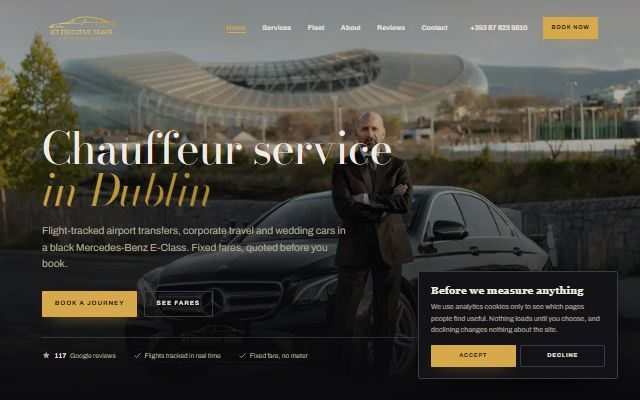

# Abraham Sabu Kurian — Portfolio

I build AI pipelines, tools and websites. **[Open the portfolio site →](https://abrahamsabu.github.io/portfolio/)**

**Best first:**

| # | Project | What it is | See it |
|---|---|---|---|
| 1 | [**auto-websites**](projects/auto-websites) | Finds local businesses with no website and has Claude Code design, build and deploy a bespoke site for each. 39 are live. | [The 39 sites](https://abrahamsabu.github.io/portfolio/gallery/#auto-built) |
| 2 | [**Heloria Sim**](projects/heloria-sim) | Open-source rocket flight simulator: one design through OpenRocket, RocketPy and a built-in model, compared, then thousands of Monte Carlo flights | [Project page](https://abrahamsabu.github.io/portfolio/projects/heloria-sim/) |
| 3 | [**Heloria Labs website**](projects/heloria-next) | Next.js site built around a WebGL machine that assembles as you scroll | [Live](https://heloria-next.vercel.app) |
| 4 | [**UCAT Prep**](projects/ucat-tracker) | Free UCAT study app: a plan built from your test date, AI-written practice questions, timed sections, mocks and an error log | [Open the app](https://abrahamsabu.github.io/portfolio/projects/ucat-tracker/) |
| 5 | [**GTM pipeline**](projects/gtm-pipeline) | Job ads → ranked shortlist → crawled briefs → one Claude research session per company → prospect board | [How it works](projects/gtm-pipeline) |
| 6 | [**Clipping**](projects/clipping) | Local Opus Clip-style tool that turns long videos into vertical captioned clips, with no API keys | [How it works](projects/clipping) |
| 7 | [**Kríos market research**](projects/krios-research) | Sourced competitive analysis, rendered by a renderer with no dependencies | [Report](https://abrahamsabu.github.io/portfolio/projects/krios-research/report.html) |
| 8 | [**Heloria Labs site, first version**](projects/helorialabs-site) | Static HTML/CSS/JS with anime.js motion | [Live](https://heloria-labs.vercel.app) |
| 9 | [**Kríos blog agent**](projects/krios-blog-agent) | Instructions for an agent that writes a weekly post and opens a PR | [Instructions](projects/krios-blog-agent/AGENT.md) |

## Websites

The **[gallery](https://abrahamsabu.github.io/portfolio/gallery/)** has 48 sites, best first. Nine were hand-built, and 39 were
built hands-off by auto-websites.



## Repo layout

```
index.html       portfolio site (GitHub Pages)
projects/        one folder per project: README, screenshots, code
gallery/         every website, viewable in the browser
assets/          shared styles and site screenshots
```
