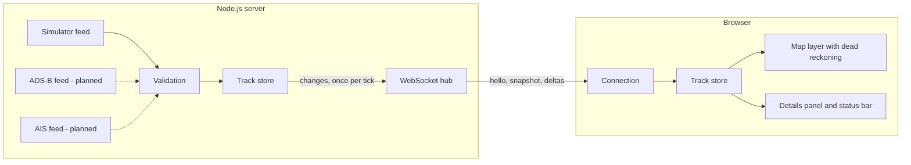

# Watchfloor

A real-time **common operating picture (COP)**: live air and sea tracks on a tactical map, drawn with NATO-standard MIL-STD-2525 symbols.

> Screenshot goes here. Run the app, select a track, and add an image to `docs/`.

Right now Watchfloor runs on a built-in traffic simulator over the English Channel. The architecture is built so live ADS-B (aircraft) and AIS (ships) feeds plug into the same pipeline without changes downstream.

## What it does

- Streams a live picture to the browser over WebSockets, sending only what changed each second
- Draws each contact with its MIL-STD-2525C symbol, callsign label and a speed leader showing where it's heading
- Moves symbols smoothly between reports using dead reckoning, so tracks glide instead of jumping
- Fades tracks that stop reporting, then removes them after a timeout that depends on whether they're aircraft or ships
- Lets you select a track to see its position, course, speed, altitude and report age, and follow it across the map
- Survives network trouble: automatic reconnect with backoff, a heartbeat watchdog, and resync for slow clients
- Simulates about 85 contacts: airliners on airways, a maritime patrol racetrack, an unidentified drone, merchant ships in the real Dover Strait shipping lanes, cross-channel ferries, fishing and leisure boats

## Quick start

Requires Node.js 20.12 or newer.

```bash
npm install
npm run dev
```

Open http://localhost:5173. The server runs on port 8080 and Vite proxies the WebSocket to it.

For production, as a single process on one port:

```bash
npm run build
npm start          # http://127.0.0.1:8080
```

Other commands:

| Command | What it does |
| --- | --- |
| `npm test` | Unit tests (Vitest) |
| `npm run typecheck` | Strict TypeScript checks across all packages |

Settings live in `.env` (copy `.env.example`). For example, `SIM_SEED` makes the simulated traffic identical every run, and `VITE_MAP_STYLE_URL=offline` runs without basemap tiles.

## Architecture



The project is an npm workspace with three packages:

```
shared/   Track type, message protocol, geodesy, input validation (used by both sides)
server/   Feeds, track store, WebSocket hub, static hosting
client/   MapLibre map, symbology, UI
```

### Design decisions

**One track shape everywhere.** Every feed translates its data into the `Track` type in `shared/src/track.ts`. The server, protocol and UI never know where a track came from, which is what makes adding a new feed a contained change.

**Validate at the edge.** All reports pass through `sanitizeTrack` before entering the store. It rejects data that can't be trusted (NaN positions, out-of-range coordinates, timestamps from the future) and repairs what it can, such as headings of 365°.

**Batch updates, don't stream every report.** Feeds may report hundreds of times a second. The store records which tracks changed, and once per tick the hub sends a single delta containing only their latest state. The payload is serialised once and shared by every client.

**Idempotent protocol.** A client gets `hello`, then a full `snapshot`, then a `delta` every tick. Applying a delta twice, or removing a track the client never had, is harmless, so reconnecting needs no special handling. The protocol is versioned, and an out-of-date page tells the user to reload instead of misreading messages.

**Server time, not browser time.** Track ages and dead reckoning compare server timestamps with "now". The client estimates its clock offset from every message, so a browser clock that's a few seconds off doesn't make tracks look stale.

**Deterministic simulation.** The simulator uses a seeded random number generator and an injectable clock, so tests can run an hour of traffic in milliseconds and get the same result every time. Ships only move along defined lanes, routes and areas, which keeps them at sea without coastline data. Aircraft and ships have realistic turn rates, acceleration and report intervals, and transponders occasionally go quiet.

## Roadmap

- [x] Simulator, WebSocket pipeline, symbology, selection and details
- [ ] Track history trails and a sortable, filterable track list
- [ ] Live aircraft from the OpenSky Network API
- [ ] Live ships from AISStream.io
- [ ] Geofences with entry and exit alerts
- [ ] Operator tagging of affiliation (friend, neutral, unknown and so on)
- [ ] Recording and a replay timeline

## Data and credits

- Basemap: © OpenStreetMap contributors, © CARTO
- Symbols: [milsymbol](https://github.com/spatialillusions/milsymbol)
- Map rendering: [MapLibre GL JS](https://maplibre.org/)

All traffic in simulation mode is invented, including callsigns and vessel names. This is a portfolio project and must not be used for navigation.
