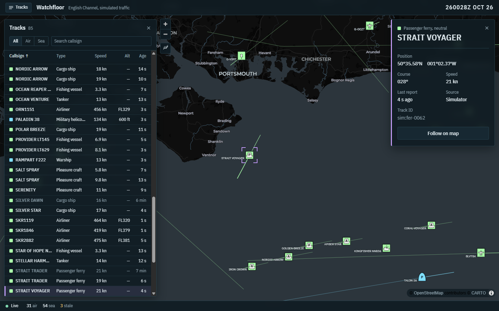
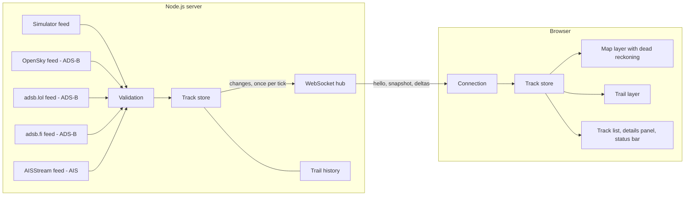

# Watchfloor

A real-time **common operating picture (COP)**: live air and sea tracks on a tactical map, drawn as vehicle shapes or as NATO-standard MIL-STD-2525 symbols.

**[Try the demo in your browser →](https://abrahamsabu.github.io/portfolio/demos/watchfloor/)** It runs a simulated world entirely in the page, about 4,000 aircraft and ships on real routes between real airports and along the main shipping lanes, with the day's real political news from [GDELT](https://www.gdeltproject.org/) on top: nothing to install, no account. The traffic is simulated and labelled so; the headlines are real and verbatim.



By default Watchfloor opens on the live world: aircraft everywhere from the [OpenSky Network](https://opensky-network.org), filled in from two volunteer ADS-B networks, [adsb.lol](https://adsb.lol) and [adsb.fi](https://adsb.fi), wherever you zoom in to a region, and ships everywhere from [AISStream](https://aisstream.io). Cork, in the south of Ireland, is the home area those two networks keep warm. It can also run offline on a built-in traffic simulator over the English Channel (`FEEDS=sim` with `SCENARIO=english-channel`). Every feed plugs into the same pipeline, so nothing downstream knows or cares where a track came from.

## What it does

- Shows real aircraft from the OpenSky Network, polled within its free daily credit budget, filled in from a second network (adsb.lol) where you're zoomed in, real ships streamed from AISStream, or simulated traffic, and always says which
- Streams a live picture to the browser over WebSockets, sending only what changed each second
- Draws each contact as a top-down shape of what it is (airliner, business jet, helicopter, drone, tanker, fishing boat...), pointing along its course and roughly to size, or as its MIL-STD-2525C symbol (`S` switches), with a callsign label and a speed leader showing where it's heading, or as a small identity-coloured dot when zoomed out to a continent or the world
- Moves symbols smoothly between reports using dead reckoning, so tracks glide instead of jumping
- Fades tracks that stop reporting, then removes them after a timeout that depends on the track type and how often its source reports, and says in the status bar when a live feed is rate limited or not responding
- Shows where each track has been with a history trail, for all tracks, only the selected one, or none — drawn as a line, or as a radar scope's discrete fading blips (Layers menu)
- Hangs an ATC-style data block off the selected track: callsign, then a line that timeshares altitude and speed with type and squawk, the way a controller's STARS or ERAM block does
- Hooks a pair of tracks like a CIC console (X): a line between the selection and a second track with live range, true bearing, closing speed and the closest point of approach on present courses
- Lists every track, all 7,000+ of them worldwide, in a sortable table you can filter by air or sea and search by callsign; selecting a row selects the track on the map, and the other way round
- Shows the whole path of a selected track, as far back as the server has it: up to 12 hours for aircraft and 24 for ships, with the start of a flight filled in from OpenSky when we only saw it mid-air, and a button to fit it on screen
- Names any track you point at in a small card (callsign, model, altitude, speed), at every zoom, and explains every colour, symbol and line in a map key (?)
- Filters the whole picture (map, trails, list and counts) by vehicle type, from airliner and helicopter to tanker and warship, by data source, and by whether stale tracks show, with a live count beside each choice (F)
- Lets you select a track to see its position, course, speed, altitude and report age, and follow it across the map
- Says who and what a selected track is: a photo of the actual aircraft (credited to its photographer on Planespotters.net), the airline flying it, the country it's registered in, or which country's military it belongs to; for a ship, a photo from Wikimedia Commons when it has one, its exact type (tug, pilot vessel, tanker...), class, operator and year built from Wikidata, its flag, destination and ETA, size, IMO number and radio call sign
- Shows political news from around the world on the map, live from the GDELT Project: a marker where each story happened (conflict, protest, elections, diplomacy, politics), cards that pop up one at a time as new stories arrive, a scrolling ticker in the style of an intelligence feed, a soft glow where the day's stories gather, a closable briefing of the last six hours' top stories (B), and optional read-aloud (N to show or hide)
- Raises an alert when an aircraft squawks an emergency code (7500 unlawful interference, 7600 radio failure, 7700 emergency): a card naming the aircraft and an amber ring on the map, once a second report confirms the code
- Shows earthquakes (USGS, magnitude 2.5 and up, the past day) and current disasters from GDACS (cyclones, floods, volcanoes, droughts, wildfires), sized by strength or alert level, with a card per event and an alert when a strong one appears (H to show or hide)
- Gives a briefing on any country when you click its name: the day's news placed there, how many of its aircraft and ships are on the map (by registration and flag), and earthquakes or disasters that name it
- Gathers every map toggle in one Layers menu (M), each with a line saying what it shows and its key
- Finds anything with a place in one search (`/` or Ctrl K): tracks by callsign, squawk, type or model, airports by code or name, chokepoints and your watch areas — and flies the camera there in one cinematic arc, the same move every alert and briefing pick uses
- Gives a cinematic tour (G): the camera rides between whatever is happening — emergency squawks first, then the watchers' findings, fresh disasters, the top stories and the busiest chokepoints — until any key or touch hands control back
- Notices things by itself (D to show or hide): the server sweeps the whole picture for aircraft flying circles (two full turns inside a tight radius, from path geometry — news helicopters, surveillance orbits, SAR patterns, holding stacks), ships that stop transmitting while under way ("AIS contact lost", a fading ghost at the last-known position), pairs of military aircraft converging (closest point of approach under 5 km within ten minutes), and rare aircraft in flight (an Airbus Beluga, a Dreamlifter, an An-124, a B-52: types built in tiny numbers, with the count from the aircraft database, "1 of 5 in the aircraft database", and never one whose owner asked not to be tracked) — each an observation with its measurements, never a claim about intent, drawn as a quiet blue ring with a card when a new one starts
- Reads back a watch handover (V): the server keeps a rolling 24-hour log — emergency squawks starting and ending, findings beginning and resolving, significant hazards appearing — each line worded when it happened from the facts at hand; newest first, a click flies to where it happened, and Read aloud speaks the latest
- Scrubs through time on one bar (Z): drag left of NOW to replay the last six hours from the paths the server already keeps (play at 60×, 300× or 900×), drag right to project up to thirty minutes ahead by dead reckoning, ghosts threaded back to the present — and the tag always says which moment is on screen, LIVE, REPLAY or PROJECTED
- Tells you what that plane is (`/sky.html`, on a phone): point the phone at an aircraft in the sky and it locks on and names it: callsign, airline, type, route ("Manchester → Zürich"), altitude, speed and distance, with a disc of the sky that turns as you do and tells you which way to move to find one. Needs the live server over https (phones only share location and compass with secure pages)
- Turns into a phosphor scope (Layers → Display): the whole plotting surface through one green gun, and a long-exposure film that lets every route burn in as a glowing thread while the camera holds still
- Works as a screensaver: open `/?screensaver` and the tour starts itself and resumes after a quiet minute; `scripts/watchfloor-screensaver.cmd` opens it as a full-screen kiosk
- Can ping on an alert: a short synthesised two-note sound for squawks and watch-area crossings, off by default (the Layers menu's Alerts section)
- Shows weather radar (R): the latest rain and snow picture from RainViewer, in grey so it never reads as an identity colour
- Watches areas you draw (W): an alert when an aircraft or ship crosses in or out (aircraft, ships or both, military only if you like), a live count inside, and an activity log; kept in your browser, alerting while the page is open
- Counts the ships in eight shipping chokepoints (Hormuz, Bab-el-Mandeb, Suez, Singapore, the Bosphorus, Gibraltar, Dover, Panama) and how many are under way, as tags on the map (C to show or hide); free AIS coverage is mostly European, so some counts are thin, and the key says so
- Marks about 6,000 airports: the largest from the globe, more as you zoom in, with codes and then names, and the name, city and codes on hover (A to show or hide); click one for its latest weather report (decoded, with the raw METAR) and the aircraft arriving and leaving right now
- Survives network trouble: automatic reconnect with backoff, a heartbeat watchdog, and resync for slow clients
- Simulates about 85 contacts: airliners on airways, a maritime patrol racetrack, an unidentified drone, merchant ships in the real Dover Strait shipping lanes, cross-channel ferries, fishing and leisure boats

## Quick start

Requires Node.js 20.12 or newer.

```bash
npm install
npm run dev
```

Open http://localhost:5173. The server runs on port 8080 and Vite proxies the WebSocket to it.

### As a screensaver

Opening the page with `?screensaver` turns it into a self-driving display:
the cinematic tour starts as soon as the picture arrives, any input pauses
it, and after a quiet minute it rides on. While the window is hidden or
minimised the tour stops and the page stops drawing, so an unseen
screensaver costs next to nothing; it rides on when shown again. On screen
it runs deliberately cold: the whole page is capped at 30 fps, the map
renders at 1:1 pixels rather than the display's scaled resolution, and
tracks redraw in whole-pixel steps — a screensaver watched from across the
room, not a benchmark.

After `npm run build`, `scripts\install-screensaver.cmd` installs it for the
current user, no admin needed: a dedicated server starts at logon (port
8088, its own picture cache, so it never collides with `npm run dev` on
8080), and a Task Scheduler idle trigger opens a full-screen Edge kiosk on
the tour after ten quiet minutes — Esc leaves it.
`scripts\watchfloor-screensaver.cmd` opens the kiosk by hand, and
`scripts\uninstall-screensaver.cmd` removes the lot. The server runs with
no window (nothing to close by accident), restarts itself if it ever
stops, and logs to `.cache\server.log`. To stop it, run
`scripts\stop-watchfloor-server.cmd`; after rebuilding, stop it and run
`scripts\watchfloor-server.cmd` again (each AISStream instance also holds
one of the key's three connections).

For production, as a single process on one port:

```bash
npm run build
npm start          # http://127.0.0.1:8080
```

Other commands:

| Command | What it does |
| --- | --- |
| `npm test` | Unit tests (Vitest) |
| `npm run typecheck` | Strict TypeScript checks across all packages |
| `npm run aircraft-db` | Download the aircraft database (about 8 MB, into `.cache/`) so aircraft show their real type and model, plus the airline list that names the airline behind a callsign; rerun to refresh |

Keyboard shortcuts:

| Key | Action |
| --- | --- |
| `L` | Open or close the track list |
| `/` | Search the track list |
| `↑` `↓` `Enter` | Move through the list and select a track |
| `T` | Cycle trails: all tracks, selected only, off |
| `F` | Open or close the filter |
| `S` | Switch between vehicle shapes and MIL-STD-2525C symbols |
| `?` | Open the map key: what colours, symbols, dots, rings and lines mean |
| `Esc` | Close the filter, or clear the selection |

Settings live in `.env` (copy `.env.example`). Aircraft need no key; ships need a free AISStream key (see Live ships). For example, `FEEDS=sim` with `SCENARIO=english-channel` runs the offline simulator (`SCENARIO=world` simulates the whole globe, as the demo does), `SIM_SEED` makes it identical every run, and `VITE_MAP_STYLE_URL=offline` runs without basemap tiles.

### Live aircraft

Add `adsblol` to `FEEDS` (for example `FEEDS=opensky,adsblol`) to fill in aircraft OpenSky's receivers miss from a second volunteer network, adsb.lol. It's free and needs no key, but it only answers "aircraft within 250 nm of a point", so it covers views up to about a region (roughly zoom 6 and closer) and stands aside when you zoom out further. In a side-by-side test over five African areas it added only a handful of aircraft: both networks rely on ground receivers, and both saw nothing around Lagos or Addis Ababa. Only satellite ADS-B fills those gaps, and that's enterprise-priced.

`adsbfi` adds a third network, [adsb.fi](https://adsb.fi), which answers the same kind of query in the same format with a documented limit (1 request a second). It's in the default `FEEDS` beside adsb.lol: either one alone keeps aircraft on the map. `ADSBFI_POLL_S` (default 5) and `ADSBFI_WARM_POLL_S` (default 30) set its intervals.

Set `FEEDS=opensky` in `.env` for real aircraft over the scenario's area, or `FEEDS=sim,opensky` for both. Add `OPENSKY_AREA=world` for every aircraft OpenSky can see, about 7,000 at once, or `OPENSKY_AREA=viewport` for anywhere in the world but only what's on screen, which is much cheaper when zoomed in. The top bar says whether the picture is live, simulated or both.

No account is needed. OpenSky gives anonymous users 400 credits a day, and one poll of the English Channel box costs 1 credit, so the default interval is a budget decision:

| Access | Credits a day | Default poll | Live data lasts |
| --- | --- | --- | --- |
| Anonymous | 400 | 60 s | about 6.7 hours a day |
| Free account (`OPENSKY_CLIENT_ID`, `OPENSKY_CLIENT_SECRET`) | 4,000 | 15 s | about 16.7 hours a day |

Those figures are for the Channel box. A worldwide poll costs 4 credits, so anonymous access gives about 1.7 hours of viewing a day at 60 s, and a free account about 16.7 hours at 60 s. Viewport mode costs 1 credit a poll zoomed in to a region (zoom 8 or closer), 2 for a country-sized view, and 4 zoomed out to the world, so it stretches the same allowance up to four times further. For worldwide use, an account is the practical choice.

Polling pauses while no browser is connected, so credits are only spent while someone is watching; a page reload doesn't pause it or trigger an extra poll. Change the interval with `OPENSKY_POLL_S`. When the credits run out, OpenSky returns 429 with the time to wait; Watchfloor waits exactly that long, the status bar says when polling resumes, the tracks fade and drop, and polling resumes by itself. `/healthz` shows credits remaining and the last error. To rehearse failures without spending credits, point `OPENSKY_API_URL` at a local stub.

### Live ships

Add `ais` to `FEEDS` (for example `FEEDS=opensky,ais`) for real ships from [AISStream](https://aisstream.io), which relays AIS, the radio messages ships broadcast about their position and identity. It's free but needs an API key: sign in at aisstream.io, create a key on the Account page and set `AISSTREAM_API_KEY` in `.env`. Without a key the feed doesn't connect and the status bar says "AISStream off" instead of claiming live traffic.

`AIS_AREA` picks what to stream: the scenario's area (default), `world` (every ship AISStream's coastal receivers hear), or `viewport` (only what browsers are looking at). AISStream pushes messages as its receivers hear them, so there's nothing to poll: one WebSocket stays open all the time, watched or not, so the picture is ready when a page opens. AIS has no replay, so ships appear as they next report: within seconds for ships underway, up to three minutes for moored ones. A key allows three connections at once. To rehearse failures without using one, point `AISSTREAM_URL` at a local stub.

What to expect, measured in October 2026:

| Area | Messages a second | Ships on the map |
| --- | --- | --- |
| Cork (default) | about 0.5 | 15 to 20 |
| English Channel | about 4 to 5 | about 750 after 8 minutes |
| World | about 110 (peaks over 200) | about 20,000 after 10 minutes, still growing |

Coverage follows AISStream's volunteer receivers, so it's dense around Europe, including river barges on the Rhine and Danube, and thin elsewhere: a 30-second look at the Singapore Strait, one of the busiest waterways in the world, showed 5 ships. The world view works, but it's heavy: at 17,000 ships the browser spent about 30% of its main thread on long tasks in headless Chrome, and a snapshot is 4.7 MB before compression. `scenario` or `viewport` is the practical choice. Expect most ships to show as a generic vessel for the first few minutes. Ship types arrive in static messages only every six minutes, and receivers miss many, so after 8 minutes about one Channel ship in five had a specific type. A third of the ships that do send a type are tugs, dredgers, pilot boats and other service craft, which draw as a generic vessel anyway.

## Architecture



The project is an npm workspace with three packages:

```
shared/   Track type, message protocol, geodesy, input validation (used by both sides)
server/   Feeds, track store, WebSocket hub, static hosting
client/   MapLibre map, symbology, UI
```

### Design decisions

**One track shape everywhere.** Every feed translates its data into the `Track` type in `shared/src/track.ts`. The server, protocol and UI never know where a track came from, which is what makes adding a new feed a contained change.

**Validate at the edge.** All reports pass through `sanitizeTrack` before entering the store. It rejects data that can't be trusted (NaN positions, out-of-range coordinates, timestamps from the future) and repairs what it can, such as headings of 365°.

**Batch updates, don't stream every report.** Feeds may report hundreds of times a second. The store records which tracks changed, and once per tick the hub sends a single delta containing only their latest state. The payload is serialised once and shared by every client.

**Idempotent protocol.** A client gets `hello`, then a full `snapshot`, then a `delta` every tick. Applying a delta twice, or removing a track the client never had, is harmless, so reconnecting needs no special handling. The protocol is versioned, and an out-of-date page tells the user to reload instead of misreading messages.

**Trail history lives on the server too.** Deltas carry only each track's latest state, and a browser that has just connected has seen nothing yet. So the server records every accepted report into a short per-track history (5 minutes for aircraft, 30 for ships) and includes it in the snapshot. A reloaded page shows full trails straight away. After that, the browser extends trails from each delta. Both sides use the same `TrailHistory` class from `shared/`, so they skip near-duplicate points and expire old ones identically. Trails show only *reported* positions, never estimated ones, so they never claim the track was somewhere it wasn't seen.

**Redraw only what changes.** Trails change only when a report arrives, so they're rebuilt about once a second. The short segment joining the last report to the moving symbol changes every frame, so it lives in its own small source. The 10 Hz work stays at one segment per track however long the trails get.

**Scale to the whole world by not doing work nobody can see.** Worldwide there are 7,000+ aircraft, against the simulator's 85. Four measures keep the browser smooth, each tested and measured in headless Chrome:

- *Redraw only as often as anything can visibly move.* At zoom 2 a pixel is about 20 km, so a jet takes over a minute to cross one. The render interval comes from the zoom: often enough that a 300 m/s jet moves at most half a pixel per frame, between 10 Hz (zoomed in) and 1 Hz (world view).
- *Draw only what's near the screen.* Every track is still dead-reckoned, but only those in the view plus a margin become map features. Zoomed in, that cut main-thread work from 1,450 to 208 ms per 3 seconds.
- *Dots below zoom 5.* Thousands of overlapping symbols read as a smear, so a circle layer coloured by identity takes over, and speed leaders aren't computed at all.
- *A windowed track list.* Only the rows in view exist (34 of 6,934 in testing), with spacer rows giving the scrollbar its full height. Screen readers still get the real size and position through `aria-rowcount` and `aria-rowindex`.

**Backpressure measured in ticks, not bytes.** The hub pauses clients that fall behind and later resyncs them with a snapshot. It used to judge "behind" by bytes buffered, and a worldwide snapshot is 2.5 MB on its own, so every new client looked slow, got another snapshot, and looked slow again: 29 snapshots in 1.5 seconds in a test. Now the hub counts deltas not yet written. Deltas waiting behind a snapshot don't count, so a resync can never start while a snapshot is still being sent.

**A list that doesn't fight the operator.** The track list updates every second, but its rows are kept per track and only moved when the order actually changes. Scroll position, hover and keyboard focus survive the updates. Sorting puts missing values (a ship's altitude, an unknown callsign) last in either direction, and breaks ties on track id so equal rows don't swap places every second. The filtering and sorting are pure functions with their own tests.

**Source time, not receive time.** Every report is stamped with when the source observed the position, not when we received it. It matters with live data: in testing, OpenSky was still listing a low-flying medical helicopter whose last position was five and a half minutes old. Stamped with receive time it would have looked live and been dead-reckoned from a stale fix; stamped with OpenSky's position time it correctly fades and drops.

**Staleness sized to the source.** Aircraft transponders report every second or so, so the default is to fade an aircraft after 30 s of silence. A polled feed is different: OpenSky data arrives in bursts every 10 to 60 seconds and is already up to 25 s old when it lands. So staleness rules can be overridden per source, and the OpenSky rule is derived from the poll interval: fade after two missed polls (one slow poll shouldn't fade the whole sky) and drop after about six. Server and client look rules up through one function, so they can't disagree.

**Live data on a budget, failing gracefully.** OpenSky's free tier is a daily credit allowance, so the poll interval is set by how long the credits should last, and retries never go faster than the normal interval. A 429 means waiting exactly as long as OpenSky says; network errors and 5xx responses back off exponentially with jitter. Failures never throw out of the feed: they just stop new reports, and the picture degrades visibly through the normal staleness rules instead of freezing. The feed takes `fetch`, the clock and timers as parameters, so tests replay recorded OpenSky responses and script 429s without touching the network.

**Spend credits only on an audience.** The hub reports how many browsers are connected, and feeds get an optional "is anyone watching?" hint. The simulator ignores it; the OpenSky feed skips its next due poll when the room is empty. Because it pauses at the next due poll rather than at once, the pending timer acts as a grace period and a page reload never pauses it. Resuming polls at the time already scheduled, never sooner, so ten quick reloads can't spend ten credits and a 429 wait still holds. The server also starts paused, so development restarts don't spend credits either.

**Poll what people are looking at.** In viewport mode each browser tells the server what's on screen, and the server asks OpenSky for just that. A pure planner turns views into the cheapest requests: it splits views that cross the antimeridian (OpenSky can't take those), rounds outward to whole degrees so small pans don't change the request, and chooses between separate small boxes, one box around them all, or the whole world. Panning somewhere new brings the next poll forward, debounced so a multi-step zoom costs one poll, and never within 10 seconds of the last one or into a rate-limit wait (3 seconds for adsb.lol, which is free). Browser messages are untrusted input, because they decide what a paid API is asked for: they're strictly parsed, size-capped at 4 KB, and coalesced to one report per tick. In testing, opening on the Channel cost 2 credits a poll instead of the world's 4.

**Several providers, one aircraft, one track.** OpenSky and adsb.lol both report aircraft by their ICAO transponder address, and both feeds use it as the track id (`adsb:4ca7b3`), so a plane both networks see is one track, not two. The store already keeps only the newest report per track; the new rule is that a newer report can't erase identity: a known callsign stays if the newer report lacks one, and a generic "aircraft" never replaces a specific "airliner", so symbols don't flicker between providers. Position, speed and altitude always come from the newest report. Both providers' ADS-B categories go through one shared table, the details panel names who delivered the latest report ("ADS-B via adsb.lol"), and the map credits each provider, with adsb.lol's ODbL licence. The polling schedule (pausing with no viewers, debounced early polls) lives in one shared `PollScheduler`, so the second feed reused it instead of copying subtle code.

**Open on a full picture, like a flight tracker.** Flightradar24 feels instant because its servers collect all the time and a page just reads what's already there. Watchfloor already sent a full snapshot to every new page; what was missing was a picture worth sending. Feeds used to sleep while nobody watched (to save OpenSky credits), and AIS can't be asked for the current picture at all: a ship appears only when it next reports, up to three minutes later at anchor. So a page opened after a quiet spell watched the map fill a few contacts at a time. Now the home area stays warm: adsb.lol polls it every 30 seconds with nobody watching and every 10 seconds when someone is (a viewer arriving to older data gets a poll within about a second), the AIS stream stays open, and the store is saved to disk every 30 seconds and restored at startup, so even a restart opens full. Measured in headless Chrome: a returning visitor used to see aircraft after 4.5 seconds and ships after 5.8; now both appear at about 1.9 seconds, of which 0.7 is the page itself loading. After a restart, aircraft and ships come back from the saved picture in the same 1.9 seconds instead of trickling in over minutes. adsb.lol publishes no rate limit and calls its limits dynamic, so the feed is careful with it: requests start at least 1.2 seconds apart (six in about a second drew a 429; ten a second apart didn't), and polls are held at least 8 seconds apart per circle, which means 6 requests a minute for Cork and never more than 7.5. Getting there cost a lesson: a wide view's 7 circles every 10 seconds, plus a test server restarted over and over, used up the allowance for our address entirely for a while. A free service run by volunteers deserves a budget even when it doesn't publish one.

**Two free networks, because either can refuse.** That lesson also showed a single point of failure: while adsb.lol refused our address, the map had no aircraft at all. adsb.fi runs the same software (readsb) and answers in the same JSON, so the adsb.lol feed became one `ReadsbFeed` class set up per service: a URL pattern, a name and a request budget (`feeds/readsb/services.ts`). Both feed the same `adsb:<icao24>` tracks, so the store's existing merge rules apply unchanged and whichever network answered last wins. adsb.fi documents 1 request a second and counts 4xx answers toward a temporary ban, so it's asked at most 30 times a minute (every 5 s for Cork while watched). Measured with adsb.lol still refusing us: aircraft over Cork appeared at 2.1 seconds, from adsb.fi alone. A 429 without a Retry-After now reads "rate limited, resumes …" instead of "not responding", because that's what it is.

**The whole world, and measuring before believing.** The default is now worldwide: OpenSky polls the globe (4 credits a poll, so every 60 s even with an account: 1.7 hours of viewing a day anonymously, 16.7 with one) and AISStream streams every ship it hears. Zoomed out, positions were already recomputed at most once a second (`renderRate.ts`: a 300 m/s jet takes a minute to cross a pixel at zoom 2), and below zoom 5 tracks are plain dots. A first measurement said that was enough: no long tasks at all. It was wrong. The long-task observer had never been installed (the CDP script needed `Page.enable`), and a probe that blocks for 120 ms on purpose proved it. Measured properly, with 11,000 aircraft and 26,000 ships loaded, 28.6 seconds of every minute went to tasks over 50 ms. A CPU profile put most of it in MapLibre serialising GeoJSON for its worker: every redraw re-sent every dot, every symbol id, and every trail. Three fixes followed the profile. Zoomed out to dots, only the selected track's trail is drawn, because a ship's 30-minute trail is about a pixel long at that zoom and every delta was rebuilding all of them. Dots no longer carry symbol ids nobody draws. And aircraft and ships got separate sources, so ships, which take minutes to cross a pixel zoomed out, redraw at most every 5 seconds while aircraft keep their 1 second. Long tasks fell to about 9 seconds a minute, and script time from about 21% to 13%; most of what's left is headless Chrome drawing in software, which a real GPU does far faster. Opening the page was slower than for Cork alone: the snapshot was 13.8 MB (9.3 MB of tracks, 4.2 MB of trails), and the page drew nothing until all of it had been built, compressed, sent and parsed.

**Shrink what every page waits for.** Measured from a plain WebSocket client, most of the opening time scaled with that size, and about 110 of each track's 250 bytes were field names. Protocol v10 sends tracks as arrays in a fixed field order, enumerated fields as their position in one shared list (the same list validation uses, so the two can't drift), observedAt as milliseconds before the message's time instead of thirteen digits, and numbers rounded to what no one can see (about 1 m, 0.1° and 0.1 m/s). Trails become one list of whole-number steps per track, which is lossless because trails were already rounded to 1 m. It's still JSON, so messages stay readable in DevTools, and the codec is two pure functions, tested by round trip, behind `encodeServerMessage` and `parseServerMessage`, so nothing else in the server or client changed. Two smaller fixes rode along: the hello goes out before the snapshot is built, and compression runs at zlib level 1, twice as fast for 12% more bytes. With about 37,000 tracks the snapshot went from 13.8 MB to 4.7 MB (1.95 MB on the wire), OpenSky's once-a-minute delta from 2.55 MB to 0.78 MB, and the map now draws 1.8 to 2.1 seconds after navigation instead of 3.5 to 3.9, timed with the page's own User Timing marks rather than the status bar, whose counts only refresh once a second. Binary formats and lazy trails were the alternatives: the first needs a dependency or a hand-written codec for little more, the second a new request flow, and neither was needed to halve the wait.

**One filter for the whole picture.** The track list already had air/sea buttons and a search, but they only narrowed the list; with 37,000 tracks the map itself needs thinning. The picture filter is one small observable object (`state/pictureFilter.ts`) that the map layers, trails, list and status bar all consult, the way they already share the selection. It records what is hidden rather than what is shown, so a vehicle type or source added later appears by default instead of being silently filtered out by an old saved setting, and a saved setting is parsed like any other input. Each choice shows a live count of the whole picture, so you can see what a box hides before unticking it, and the status bar says how many tracks are filtered out, so a thinned map is never mistaken for an empty sky. The counts are also honest about the data: most worldwide aircraft come from OpenSky without a category, so they're "Aircraft" of unknown type, and about half the ships haven't yet sent the static report that carries their type.

**Know what each aircraft is, not just where.** That honesty showed the gap: about 90% of the world's aircraft came from OpenSky with no category, so they were all just "Aircraft". The fix is a lookup, not a smarter feed. The tar1090 aircraft database (the one adsb.lol and adsb.fi use) maps about 495,000 transponder addresses to an ICAO type designator and a military flag, and its type table gives each designator a model and an ICAO class such as `L2J` (landplane, two jets) or `H2T` (helicopter, two turboshafts). A pure classifier turns those into a platform: rotorcraft and tiltrotors by class, drones and patrol aircraft by designator (the MQ-9 Reaper and P-8 Poseidon look like ordinary jets by class), business jets by model family (a Gulfstream and an A320 share a class and weight), and the rest by weight. Two types were added for what the old list couldn't say, business jets and military aircraft. The database states no licence, so it's never committed: `npm run aircraft-db` fetches it for local use and builds a 3.5 MB binary index (three sorted typed arrays searched by halving, instead of half a million strings in a Map), which the server loads in milliseconds. It's applied in one place, a hook where reports enter the store, so all three ADS-B feeds and restored pictures are typed alike, and registrations and owners are never read (owners can ask for privacy through LADD and PIA). Measured on the live world: 99.2% of aircraft typed (11,631 of 11,720), plain "Aircraft" down from about 11,000 to 91, and the details panel reads "BOEING 737 MAX 8 (B38M)". The snapshot grew 17% compressed, from 1.95 to 2.29 MB.

**Measure the wait, then cut the biggest part.** Panning used to take 6 to 8 seconds to show new aircraft. Timing each step showed where it went: the browser and server each waited for the view to settle, the server only read views once a second, and adsb.lol's circles were fetched one after another although each takes 1 to 3.5 seconds to answer. Views are now reported within 100 ms, the free provider settles faster, and its circles are fetched two at a time with each pushed as it lands. Measured in headless Chrome, a pan now shows new aircraft in about 3 seconds; most of what's left is adsb.lol's own response time. When the map is empty only because the view is too wide for adsb.lol and nothing else is delivering, the status bar says to zoom in.

**A stream needs looking after, not scheduling.** OpenSky and adsb.lol are polled; AISStream is one long-lived WebSocket. The feed sends its subscription the moment the socket opens (AISStream closes a connection that hasn't subscribed within 3 seconds), reconnects with jittered exponential backoff, and only resets the backoff after a connection has stayed healthy for 30 seconds, so a server that accepts and immediately drops can't cause a tight loop. Silence isn't a failure: an empty stretch of sea can be quiet for minutes, so liveness comes from WebSocket pings, not from message gaps. AISStream rejects a bad key by dropping the socket without a word (recorded: close code 1006 about 600 ms after subscribing), so a close before the subscription is confirmed waits at least 30 seconds and the status bar suggests checking the key. The connection negotiates permessage-deflate, because AISStream drops messages over a bandwidth limit on uncompressed connections. Socket, clock and timers are injected, so tests script drops, dead connections and rejected keys without the network, and replay a recorded Channel stream. The recording caught one place where the docs and the service disagree: the subscription confirmation carries its compression flag in a different place than documented.

**Ships report at their own pace.** A ship's AIS rate follows what it's doing: every 2 to 10 seconds underway, every 3 minutes at anchor. The sea default of fading after 90 seconds would fade every moored ship between reports, so live AIS gets its own rule through the per-source staleness overrides: fade after two missed 3-minute reports plus a margin, drop after about six. Moving ships report so often that they rarely get near either.

**Half a timestamp.** An AIS position report carries only the UTC *second* of its fix, not the date or minute. The feed rebuilds the full time from AISStream's receive time: the latest moment at or before receipt that falls on that second. A fix a few seconds "after" receipt is treated as the ship's clock running ahead, not as nearly a minute of latency. That isn't hypothetical: in a recorded two minutes of Channel traffic, 8% of fixes were stamped 1 or 2 seconds ahead of AISStream's receive time, and without the allowance they'd have been dated almost a minute too early. Codes 60 to 63 mean "no time stamp" and fall back to the receive time. The other "not available" codes (latitude 91, speed 102.3 knots, course 360, heading 511) are skipped rather than drawn, and a moving ship with no course is skipped instead of being dead-reckoned due north.

**Paths on request, not in the snapshot.** The five-minute trails go to every browser, so they stay short. A whole flight is wanted for one track at a time, so the server keeps hours of history for every track and sends one track's path only when a browser selects it. It thins as it records: each new report decides whether the previous one adds anything the straight line doesn't, so a cruising jet costs a point every few minutes while a holding pattern keeps its turns (about 77,000 points for 38,000 tracks after 7 minutes). The server only knows what it has seen since it started watching, so for an aircraft first seen at cruise it asks OpenSky's experimental tracks endpoint for the flight since takeoff, once per aircraft, capped at 60 lookups an hour, from a credit bucket separate from the map's polls. The browser gets an answer at once, then a second with the earlier part (an Emirates 777 from Gatwick, a 9-hour BA flight from Los Angeles), and extends it live. Opening the page is unchanged: tracks drawn at about 2 s, snapshot about 5.3 MB. The path is drawn in the selection colour, dashed across stretches with no reports (an ocean crossing), with a ring where it starts.

**Details on request, from the cheapest source that knows.** Selecting a track asks the server about it once (`track`, which replaced the path-only request), and the answer comes in two parts: the path, and the details. Most of the details cost nothing to look up. An aircraft's 24-bit address falls in a block ICAO gives each country (Annex 10, Table 9-1), so the address alone says "Registered in Ireland", and with the database's military flag, "United States military". A ship's MMSI starts with its flag's three-digit code from the ITU. The airline comes from the callsign's ICAO designator ("BAW4E" is British Airways), using OpenFlights' openly licensed list. Its data is old, so a new airline shows its callsign alone. Ships broadcast their voyage and hull in static messages every six minutes, which the AIS feed used to discard after taking the name and type; it now keeps destination, ETA, size, draught, IMO number and call sign. None of this goes in the snapshot, so opening the page costs the same. The photo comes from Planespotters.net's public API, fetched by the browser itself, because their terms want the viewer's own browser, a visible photographer credit and a link to the photo's page. It is fetched only for the selected aircraft, once each. Privacy holds: registrations and owners are still never shown. Aircraft whose owners have asked US authorities to keep them off public trackers (LADD), or that fly a privacy address (PIA), get no photo and no operator name. Measured live: Ryanair, UPS and American Airlines named, US Air Force aircraft shown as "United States military", and a Cayman-flagged yacht "MIAMI · ETA 21 Oct 1200Z".

**Ships get the same, from open data.** There's no free ship-photo service like Planespotters, but Wikidata records thousands of ships by IMO number and MMSI, often with a Commons photo, operator, class and year. One SPARQL query per selected ship finds it, preferring the IMO number, which stays with a hull for life. An MMSI can pass to another ship, so a match on MMSI alone must also agree with the name the ship broadcasts. Operators that are people are filtered out, so a private yacht's owner stays private. A Commons photo is shown with its author, licence and a link to its page, as its licence asks. Measured on 400 random live ships: 191 had sent static data, 53 of those are on Wikidata and 29 have a photo, mostly ferries, cruise ships and large merchant ships. The AIS type number is kept now too, so a "vessel" can read "Tug" or "Pilot vessel". What ships have broadcast is saved with the picture, because a restart otherwise lost every ship's voyage details for up to six minutes.

**Save the picture small, and without stopping the server.** By the time it held paths and ship details, the saved picture was 20.5 MB, and most of it wasn't the paths: it was 37,000 tracks written as plain objects, every field name repeated and every coordinate to 16 digits. It now uses the snapshot's compact wire form for tracks and trails, value lists for ships, and gzip, which brings it to 4.1 MB. Size wasn't the only cost. Saving froze the server's single thread for about 0.3 s every 30 seconds, long enough to delay the one-second tick that sends updates. So the save is now done in pieces of 2,000 tracks, gathered and written with the event loop running in between, and gzip runs on Node's thread pool. Measured on the same real picture, the longest stall during a save fell from about 300 ms to 30-60 ms. The old format is still read once, so the upgrade kept the picture: 37,381 tracks and 22,773 ships came back.

**A holographic display, with the colours kept honest.** The interface is drawn as glowing blue lines on dark glass, with corner brackets instead of boxes, a recoloured basemap with glowing coastlines, turning rings around the selected track and a two-second opening sequence. Zoom out and the map becomes a globe, flattening back into a normal map as you zoom in, with the night side shaded and a line where the sun is setting, worked out from the time (no data source); news cards only pop up for stories on the side facing you. The risk with a cyan HUD is that cyan already means "friend" in military symbology. So the display's own light is a deeper, bluer cyan that only ever draws lines, the basemap is kept dim, and the track colours are untouched: they're still the most saturated things on screen. Reduced motion keeps the look and drops the movement.

**News is placed by what the article says, not by its events.** GDELT reads the world's news every 15 minutes and publishes, for each article, its themes, the places it names and the events it describes ("a government did this to that party, here"). A story makes the map if its themes score as political (elections, legislation, conflict, sanctions, protest, diplomacy count up; sport, crime, company results count down) and at least one of its events involves a political actor such as a government, a military or rebels. I tuned this by hand on four real batches, about 4,000 articles: about four in five stories that pass are really political, and the ones that slip through are things like a story about the clocks changing. My first try placed each story where its most-mentioned event happened, and put an Israeli election in Qatar. The first place the article itself names turned out to be right far more often, so that's what's used, with a city in that country preferred over the country's middle. The event codes were too noisy to say what kind of story it is (a campaign-spending story came out as an assault), so the kind comes from the themes the article mentions most. Headlines are shown word for word with a link to the outlet, never summarised. "Live" here means 15 to 30 minutes, which is as fresh as free sources get, and the card says how old each story is. Batches are fetched at least 5 s apart, as GDELT asks. The day's stories are saved, so a restart doesn't empty the map.

**The briefing ranks by coverage and groups retellings, without rewriting anything.** Each story gets an importance from how widely its event is covered in its batch (sources, articles, and the same headline on other sites, on a log scale so one huge story can't drown the rest) plus how political it is (capped, so coverage decides between political stories). Within one 15-minute batch those counts are small, so the briefing also looks across the last six hours: stories sharing at least three telling words of their headlines are treated as the same story, listed once under the most important telling, and ranked up for every retelling ("+2 related"). My first rule (two shared words, or the same country) grouped five unrelated Delhi stories because they all said "Delhi", so place names no longer count. The list shows one outlet's own headline; nothing is merged or summarised.

**Watch-area alerts are tuned against noise, measured.** A track counts as entering only if it was seen live outside on the previous look and live inside now; anything already inside when the page opens, or heard for the first time inside, is counted without an alert, because nothing was seen to cross. Leaving takes two reports outside, so one jumpy position can't trigger it. My first version also logged "lost contact" whenever a track inside went stale or dropped off: on a box over the Channel holding about 1,850 tracks, that was about 40 entries a minute, mostly aircraft landing and ships between reports, and real crossings were buried. Now stale isn't lost at all (ships go stale and live all day), and tracks that drop off the map inside are counted per area rather than logged one by one. The same box now gives four or five genuine crossings a minute.

**Airports are furniture.** They come from OurAirports (public domain): large and medium airports, plus small ones with scheduled flights, about 6,000 of its 86,000 places (the rest are strips, heliports and seaplane bases). A script (`npm run airports`) turns the list into a compact file that's committed, and the browser fetches it once after the map is up, so it never delays the first picture. They're drawn as a dim ring with a runway in the display's own light, under every track, never pushing a track or its label off the map, and their labels give way to callsigns.

**Two ways to read a picture.** MIL-STD-2525C is the standard a defence operator expects, but at map size its type marks are a few pixels inside a frame, so an airliner, a helicopter and a fishing boat look the same, and nothing shows heading without the speed leader. The default is now a top-down outline per vehicle type, the way Flightradar24 reads: 15 shapes drawn for this project (`map/shapes.ts`), rotated to the course, and scaled by type, with wide-bodies picked out by ICAO designator (a 777 is drawn bigger than an A320, a Cessna smaller still). Colour still means identity only; detail lines such as container bays or a gun mount are drawn in the outline colour, so type is told by outline alone. One image per shape and identity (60 at most) keeps memory flat with 37,000 tracks, and measured main-thread cost is the same as the symbols'. Shapes rotate, so their callsigns can't be baked in the way 2525 labels are; they're a separate layer of label images in the app's typeface (no glyph server, so the offline map works), and unlike the shapes they give way to each other, so a busy airport shows some names cleanly instead of all of them overlapping. The details panel and map key draw with the same code in whichever style is on.

**Identity arrives separately.** Positions come every few seconds, names and ship types every six minutes in separate static messages (Class B ships split even those into two parts). A small registry per MMSI remembers the static half, so every position report carries the best known name and type. It's bounded, dropping the least recently heard ship, because a world subscription hears tens of thousands of ships a day. Ship types map to platforms (fishing, passenger, cargo, tanker, leisure); type 35, a ship declaring military operations, becomes a warship symbol but never an affiliation, which stays the operator's call. Coast stations, aids to navigation and distress beacons have MMSIs that aren't ships' and are left out.

**A pan costs one message.** In viewport mode the views are split at the antimeridian and snapped outward to whole degrees, as for OpenSky. But AISStream's cost is message volume, which grows with area, not a price per box, so separate views stay separate boxes. A new subscription replaces the old one on the open connection, so panning sends one small message instead of reconnecting. AISStream closes a connection that updates more than once a second, so updates go at most once every 2 seconds, always with the latest view.

**Say what's real.** The server tells the browser whether the picture is live, simulated or both, and the top bar says so. A simulated contact must never be mistaken for a real one. Likewise, when a live feed is rate limited or down, the status bar says so ("OpenSky rate limited, resumes 270000Z") instead of letting aircraft fade without explanation; a healthy feed says nothing. A feed with no API key is "off", not "not responding", and doesn't count towards "live traffic". Feed status rides on the next delta only when it changes, so the per-second message stays small.

**Server time, not browser time.** Track ages and dead reckoning compare server timestamps with "now". The client estimates its clock offset from every message, so a browser clock that's a few seconds off doesn't make tracks look stale.

**Deterministic simulation.** The simulator uses a seeded random number generator and an injectable clock, so tests can run an hour of traffic in milliseconds and get the same result every time. Ships only move along defined lanes, routes and areas, which keeps them at sea without coastline data. Aircraft and ships have realistic turn rates, acceleration and report intervals, and transponders occasionally go quiet.

## Roadmap

- [x] Simulator, WebSocket pipeline, symbology, selection and details
- [x] Track history trails and a sortable, filterable track list
- [x] Live aircraft from the OpenSky Network API, filled in from adsb.lol
- [x] Live ships from AISStream.io
- [x] Geofences with entry and exit alerts (watch areas, in the browser)
- [ ] Operator tagging of affiliation (friend, neutral, unknown and so on)
- [ ] Recording and a replay timeline

## Data and credits

- Basemap: © OpenStreetMap contributors, © CARTO
- Symbols: [milsymbol](https://github.com/spatialillusions/milsymbol)
- Map rendering: [MapLibre GL JS](https://maplibre.org/)
- Live aircraft: [The OpenSky Network](https://opensky-network.org), [adsb.lol](https://adsb.lol) (data under the [ODbL](https://opendatacommons.org/licenses/odbl/)) and [adsb.fi](https://adsb.fi) (personal, non-commercial use)
- Live ships: [AISStream](https://aisstream.io)
- Aircraft types: [tar1090-db](https://github.com/wiedehopf/tar1090-db) (Mictronics, wiedehopf), downloaded for local use and never committed
- Aircraft photos: [Planespotters.net](https://www.planespotters.net), each credited to its photographer and linked to its page
- Airline names: [OpenFlights](https://openflights.org/data.php) (under the [ODbL](https://opendatacommons.org/licenses/odbl/))
- Ship facts and photos: [Wikidata](https://www.wikidata.org) (CC0) and [Wikimedia Commons](https://commons.wikimedia.org), each photo credited to its author with its licence
- Political news: [The GDELT Project](https://www.gdeltproject.org/) (free for any use with a citation); headlines belong to the outlets that published them, and each links to its article
- Airports: [OurAirports](https://ourairports.com/data/) (public domain)
- Weather radar: [RainViewer](https://www.rainviewer.com/) (free for personal use; shown in grey, which their terms allow)
- Airport weather: [aviationweather.gov](https://aviationweather.gov/) (NOAA Aviation Weather Center)
- Earthquakes: [USGS Earthquake Hazards Program](https://earthquake.usgs.gov/) (public domain)
- Disasters: Global Disaster Alert and Coordination System, [GDACS](https://www.gdacs.org/) (automatic estimates; local authorities' warnings come first)
- Countries: ICAO Annex 10 Vol. III (aircraft address blocks) and the ITU's maritime identification digits (ship flags)

All simulated traffic is invented, including callsigns and vessel names. Live aircraft and ships come from crowd-sourced receivers (OpenSky, adsb.lol, adsb.fi, AISStream) and can be delayed, incomplete or missing; empty areas often mean no receivers, not no traffic. AIS is self-reported: a ship's name, type and position are what it broadcasts, not an identification. This is a portfolio project and must not be used for navigation.
