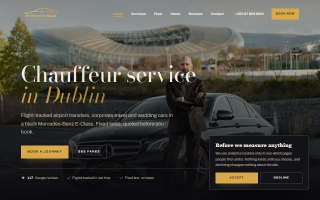

# Abraham Sabu Kurian — Portfolio

I build AI pipelines, tools and websites.

**Best first:**

| # | Project | What it is | See it |
|---|---|---|---|
| 1 | [**auto-websites**](projects/auto-websites) | Finds local businesses with no website and has Claude Code design, build and deploy a bespoke site for each. 39 are live. | [The sites](gallery/client-sites) |
| 2 | [**Watchfloor**](projects/watchfloor) | A live common operating picture of the world's air and sea traffic: tens of thousands of aircraft and ships on a tactical globe, with watchers that flag circling aircraft, silent ships and converging military, a replay timeline and a handover brief | [Live demo](https://abrahamsabu.github.io/portfolio/demos/watchfloor/) |
| 3 | [**Heloria Sim**](projects/heloria-sim) | Open-source rocket flight simulator: one design through OpenRocket, RocketPy and a built-in model, compared, then thousands of Monte Carlo flights | [Code](projects/heloria-sim) |
| 4 | [**Heloria Labs website**](projects/heloria-next) | Next.js site built around a WebGL machine that assembles as you scroll | [Live](https://heloria-next.vercel.app) |
| 5 | [**UCAT Prep**](projects/ucat-tracker) | Free UCAT study app: a plan built from your test date, AI-written practice questions, timed sections, mocks and an error log | [How to run it](projects/ucat-tracker) |
| 6 | [**GTM pipeline**](projects/gtm-pipeline) | Job ads → ranked shortlist → crawled briefs → one Claude research session per company → prospect board | [How it works](projects/gtm-pipeline) |
| 7 | [**Clipping**](projects/clipping) | Local Opus Clip-style tool that turns long videos into vertical captioned clips, with no API keys | [How it works](projects/clipping) |
| 8 | [**Kríos market research**](projects/krios-research) | Sourced competitive analysis, rendered by a renderer with no dependencies | [Report](projects/krios-research/FULL-REPORT.md) |
| 9 | [**Heloria Labs site, first version**](projects/helorialabs-site) | Static HTML/CSS/JS with anime.js motion | [Live](https://heloria-labs.vercel.app) |
| 10 | [**Kríos blog agent**](projects/krios-blog-agent) | Instructions for an agent that writes a weekly post and opens a PR | [Instructions](projects/krios-blog-agent/AGENT.md) |

## Websites

The **[gallery](gallery)** has 48 sites. Nine were hand-built, and 39 were
built hands-off by auto-websites.



## Repo layout

```
projects/        one folder per project: README, screenshots, code
gallery/         every website's source
assets/          screenshots
demos/          browser demos that run with nothing installed
render.yaml      deploy blueprint for Watchfloor on live data
```
