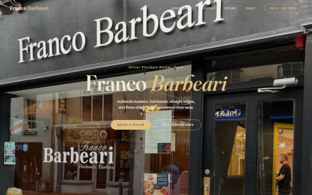
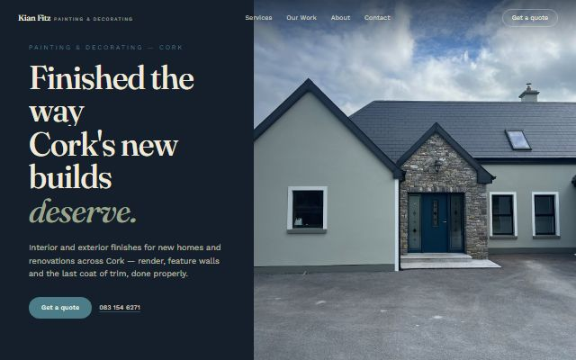

[← Portfolio](https://abrahamsabu.github.io/portfolio/) · [All projects](../../README.md) · [See the sites](https://abrahamsabu.github.io/portfolio/gallery/#auto-built)

# auto-websites

**One command finds local businesses with no website and builds each of them a bespoke site, then deploys it. No human writes the code.**

| | |
|---|---|
|  |  |
|  |  |

**44 sites built · 39 live** · [Browse all of them →](https://abrahamsabu.github.io/portfolio/gallery/#auto-built)

## How it works

1. **Find:** searches Google Places across a range of Cork business types.
2. **Filter:** keeps only the businesses that have no website.
3. **Gather:** downloads each business's real photos from Places.
4. **Build:** runs Claude Code headless on each business. It follows the design brief in
   [CLAUDE.md](CLAUDE.md): pick a palette and type for *that* business, one signature
   animation, real photos only, and a self-review loop with screenshots before it's done.
5. **Deploy:** pushes each finished site to GitHub Pages.

## Scripts

| Script | What it does |
|---|---|
| `auto-pipeline.cjs` | The full hands-off run: find, filter, gather, build |
| `find-and-build.cjs` | Find and filter into `leads.txt`, then build |
| `batch-build.cjs` | Build a site for every business in `leads.txt` and write `results.md` |
| `deploy-missing.cjs` | Push any built sites that aren't live yet |

## How to run

You need Node 18+, the `claude` CLI signed in, and a Google Places API key. The scripts
use only Node built-ins, so there's nothing to install.

1. Put the Places key in `google-key.txt` in this folder. It's gitignored.
2. `node auto-pipeline.cjs`
3. Set `PAGES_REPO` at the top of `deploy-missing.cjs` to your local Pages repo, then run `node deploy-missing.cjs`.

The build step runs Claude Code with permission prompts off, so run it in a copy of this folder.
The generated leads, results, and `sites/` folders aren't included, because they hold real businesses' details.
