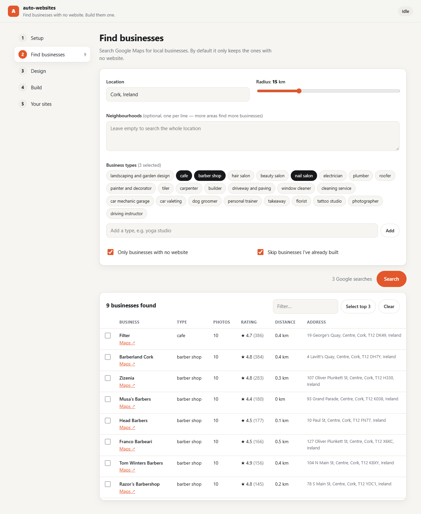

[← Portfolio](https://abrahamsabu.github.io/portfolio/) · [All projects](../../README.md) · [See the sites it built](https://abrahamsabu.github.io/portfolio/gallery/#auto-built)

# auto-websites

**Find local businesses with no website, then have Claude Code design, build and deploy a bespoke site for each one, all from a simple local app.**

| | |
|---|---|
|  |  |
|  |  |

**It built 44 sites, and 39 are live.** [Browse them →](https://abrahamsabu.github.io/portfolio/gallery/#auto-built)



## Quick start

You need [Node.js 18+](https://nodejs.org), [Claude Code](https://claude.com/claude-code) (signed in), and a
[Google Places API key](https://console.cloud.google.com/google/maps-apis) with **Places API (New)** enabled.

```bash
git clone --depth 1 --filter=blob:none --sparse https://github.com/AbrahamSabu/portfolio.git auto-websites
cd auto-websites
git sparse-checkout set projects/auto-websites
cd projects/auto-websites
node server.mjs
```

Your browser opens at **http://localhost:4321**. There's nothing to `npm install`, because the app uses only Node's built-ins.

## How it works

| Step | In the app | What happens |
|---|---|---|
| **1. Setup** | Checklist + settings | Checks Node, npm, Claude Code, git, and your Places key. You can pick a Claude model and set up deploying (optional) |
| **2. Find** | Any city, radius, neighbourhoods, business types | Searches Google Maps, keeps businesses with **no website**, ranks them by photos and reviews. You tick the ones to build |
| **3. Design** | Three editors | **Extra instructions** to steer every site quickly, the full **design brief** (`CLAUDE.md`), and the **per-site instructions** template |
| **4. Build** | Live queue | For each business: downloads its real Google photos, then runs Claude Code headless to design and build the site. It shows what Claude is doing as it happens. You can stop at any time |
| **5. Your sites** | Preview grid | Live previews, open the folder, and deploy to GitHub Pages in one click |

Each site takes about 20–40 minutes and builds on your own Claude account. Everything stays on your machine,
in `workspace/`, which is gitignored. That covers your settings, the businesses found, and the built sites.

## Make it your own

- **Any city:** type a location such as `Austin, Texas` or `Manchester, UK`. Add neighbourhoods to find more businesses.
- **Any niche:** toggle the 25 built-in business types or add your own.
- **Your style:** edit the design brief and per-site instructions in the Design tab. Reset to the defaults at any time.
- **Your hosting:** point Deploy at any local clone of a GitHub Pages repo. Each site is published to `/<business-name>/`.

## Safety

- The app only listens on `127.0.0.1`. It checks the Host header and needs a fresh token every time it starts,
  so other websites open in your browser can't control it.
- Builds run Claude Code with `--dangerously-skip-permissions` inside `workspace/`, so it can work without asking you
  to approve each step. Only run it on a machine and account you're comfortable with that on.
- Your API key is saved in `workspace/settings.json`, never shown back in the page, and only sent to Google.
  You can also pass it in as `GOOGLE_PLACES_KEY`.
- Generated sites use each business's public Google photos. They're fine for a pitch mockup. Get permission or
  licensed images before you put a paid site live.

## Project layout

```
server.mjs               local web server + API
lib/places.mjs           Google Places search, filtering, photo download
lib/builder.mjs          runs Claude Code headless and streams its progress
lib/deploy.mjs           publishes a site to a GitHub Pages repo
lib/pipeline.mjs         queue, live state, stop/resume
templates/               default design brief + per-site instructions
ui/                      the app (plain HTML/CSS/JS, no build step)
```

Settings: `PORT` changes the port (default 4321), and `AUTO_WEBSITES_WORKSPACE` moves the workspace folder.

## License

[MIT](LICENSE)
