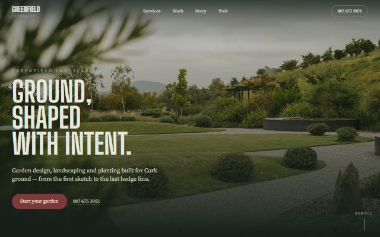

# auto-websites

A hands-off pipeline that finds local businesses with no website and builds a bespoke
pitch site for each one. One command runs the whole thing:

1. Searches Google Places across a range of Cork business types.
2. Keeps only businesses that have **no website**.
3. Downloads each business's Places photos into `sites/<slug>/photos`.
4. Runs Claude Code headless to design and build each site, following the design brief
   in [CLAUDE.md](CLAUDE.md).
5. Pushes finished sites to a GitHub Pages repo.

It built 44 sites and deployed 39 of them. You can browse them all in the
[gallery](../../gallery/#client-sites).

| | | |
|---|---|---|
|  |  |  |

## Scripts

| Script | What it does |
|---|---|
| `auto-pipeline.cjs` | The full hands-off run: search, filter, photos, build |
| `find-and-build.cjs` | Search and filter into `leads.txt`, then build |
| `batch-build.cjs` | Build a site for every business in `leads.txt`, one at a time, and write `results.md` |
| `deploy-missing.cjs` | Push any built sites that aren't on GitHub Pages yet |

## How to run

Needs Node, the `claude` CLI signed in, and a Google Places API key.

1. `npm install`
2. Put the Places key in `google-key.txt` in this folder. It is gitignored and never committed.
3. Run `node auto-pipeline.cjs`.
4. Set `PAGES_REPO` at the top of `deploy-missing.cjs` to your local Pages repo, then run `node deploy-missing.cjs`.

The build step runs Claude Code with permission prompts turned off, so run it in a
copy of this folder rather than your working one.

The generated leads, results, and `sites/` folder aren't included here. They contain
real businesses' details.
