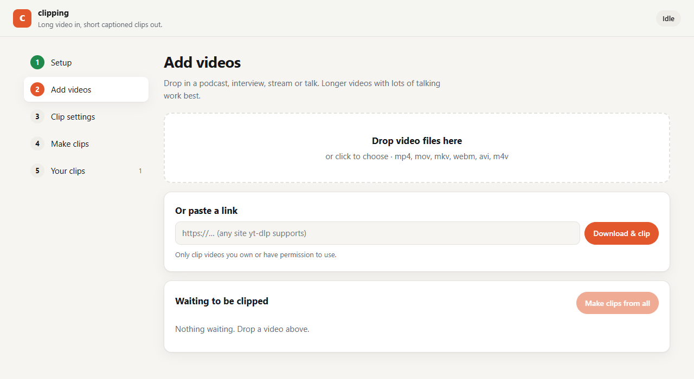
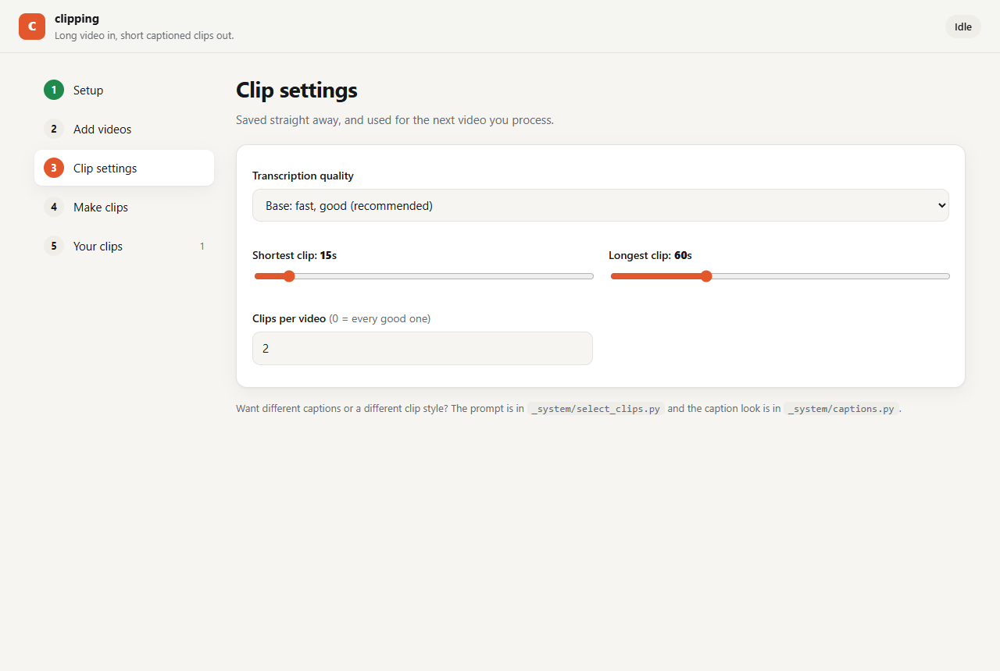

[← Portfolio](https://abrahamsabu.github.io/portfolio/) · [All projects](../../README.md)

# Clipping

**Long video in, short vertical captioned clips out. It runs on your own machine through a simple app, with no API keys.**



## Quick start

You need [Python 3.9+](https://python.org), [ffmpeg](https://ffmpeg.org), and [Claude Code](https://claude.com/claude-code)
(signed in), which picks the clips.

```bash
git clone --depth 1 --filter=blob:none --sparse https://github.com/AbrahamSabu/portfolio.git clipping
cd clipping
git sparse-checkout set projects/clipping
cd projects/clipping
```

Then double-click **`START.bat`** on Windows, or run `./start.sh` on Mac and Linux. The first run sets up Python and
installs the packages (a few minutes, once). After that it opens straight into the app at **http://localhost:4323**.

To install ffmpeg: `winget install ffmpeg` (Windows), `brew install ffmpeg` (Mac), or `sudo apt install ffmpeg` (Linux).

## How it works

| Step | In the app | What happens |
|---|---|---|
| **1. Setup** | Checklist | Checks Python, ffmpeg, Claude Code and the Python packages, with a one-click install for anything missing |
| **2. Add videos** | Drag & drop, or paste a link | Files go into `1 Drop videos here`. Links are downloaded with yt-dlp |
| **3. Clip settings** | Sliders | Transcription quality, the shortest and longest clip, and how many clips per video |
| **4. Make clips** | Live queue | **Transcribe** locally with faster-whisper → **Claude Code picks** the strongest self-contained moments → **follow the speaker** into a 9:16 frame with OpenCV → **burn in captions** with ffmpeg |
| **5. Your clips** | Player grid | Watch, save, or open the `2 Clips` folder |



## Make it your own

- **Clip length and count:** set in the app.
- **What makes a good clip:** edit the prompt in `_system/select_clips.py`.
- **Caption look** (words per line, font, position): edit `_system/captions.py`.
- **Command line:** `python _system/auto.py` processes everything waiting. Add `--watch` to keep watching the folder,
  or use `--file video.mp4` or `--url https://…` for a single video.

## Notes

- Everything stays local: your videos, clips, settings and the Python environment are all gitignored.
- Only clip videos you own or have permission to use.

## License

[MIT](LICENSE)
