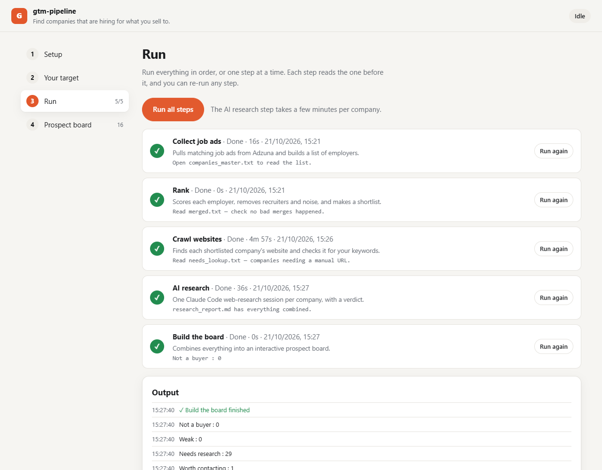
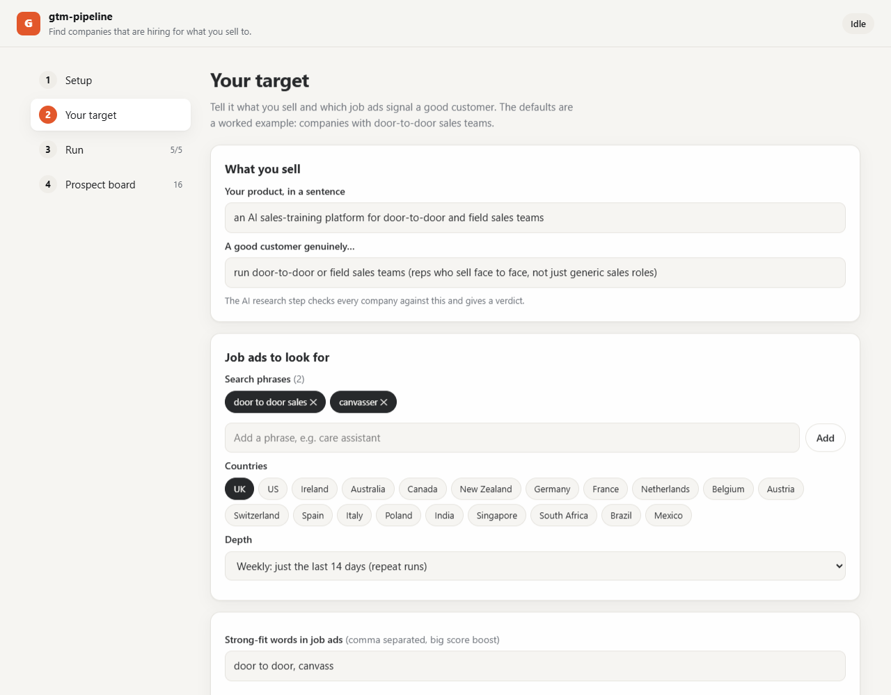

[← Portfolio](https://abrahamsabu.github.io/portfolio/) · [All projects](../../README.md)

# GTM pipeline

**Find the companies that are hiring for the roles you sell to. It ranks them, crawls their websites, has Claude research each one, and gives you a prospect board. All from a simple local app.**

My own run profiled 197 companies and researched 90 in depth.



## Quick start

You need [Node.js 18+](https://nodejs.org), free [Adzuna API keys](https://developer.adzuna.com), and
[Claude Code](https://claude.com/claude-code) if you want the AI research step.

```bash
git clone --depth 1 --filter=blob:none --sparse https://github.com/AbrahamSabu/portfolio.git gtm-pipeline
cd gtm-pipeline
git sparse-checkout set projects/gtm-pipeline
cd projects/gtm-pipeline
node server.mjs
```

Your browser opens at **http://localhost:4322**. There's nothing to `npm install`.

## How it works

| Step | What happens |
|---|---|
| **1. Collect job ads** | Pulls every job ad matching your phrases from Adzuna, across the countries you pick, and merges them into a master list of employers that grows with each run |
| **2. Rank** | Scores each employer by posting volume, phrase matches and your strong-fit words. It drops recruitment agencies and noise, and merges duplicate names |
| **3. Crawl websites** | Finds each shortlisted company's real website, reads it, and checks for words that confirm a fit |
| **4. AI research** | Opens one Claude Code web-research session per company. It covers what they do, whether they genuinely fit, size, ownership and financial health, how they train staff, your pitch angle, and a verdict |
| **5. Build the board** | Combines everything into an interactive prospect board you can filter by verdict and vertical |

You can run all five steps with one click, or re-run any single step.



## Make it your own

Everything is set in the **Your target** tab, with no code changes needed:

- **What you sell, and what a good customer genuinely does.** The AI research step checks every company against this.
- **Search phrases and countries:** the job ads that signal a buyer.
- **Strong-fit words and website words:** these drive the score.
- **Thresholds:** minimum job ads per company, minimum score, and how many companies to research.

The defaults are a worked example: finding companies that run door-to-door sales teams. The vertical labels in
`triage.js` and `report.js` are tuned for that example, so edit `VERTICAL_RULES` there for other industries.

## Your data stays local

Keys, settings, results and private notes live in `workspace/`, which is gitignored. To pin your own notes to a
company on the board, add `workspace/notes.json`:

```json
{ "Acme Ltd": { "pin": 1, "headline": "Best target", "bullets": ["Why", "And why"] } }
```

You can also run each step on its own, for example `node collect.js`. They all read `workspace/settings.json`.

## License

[MIT](LICENSE)
