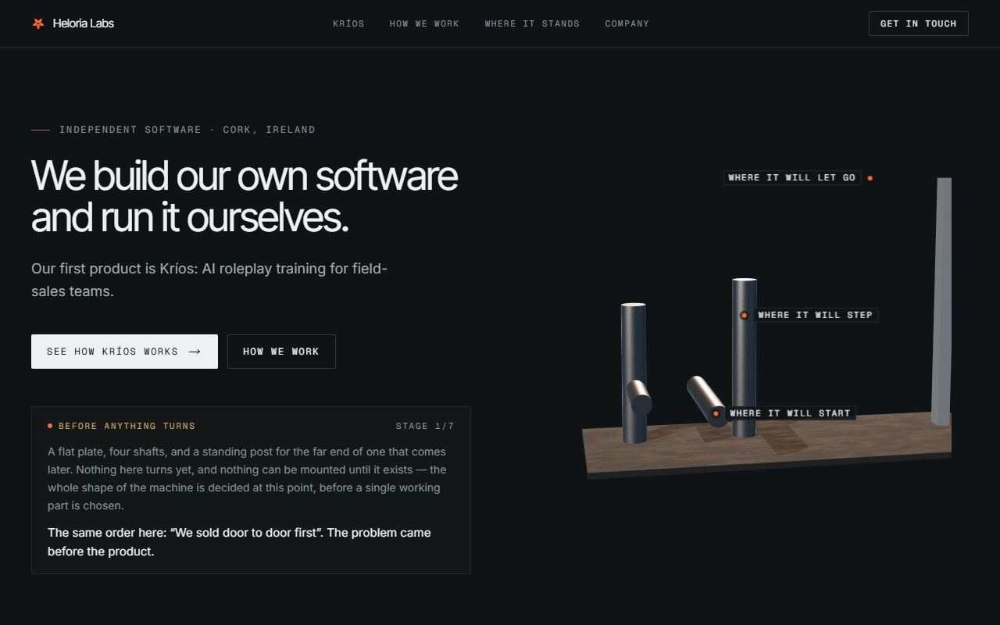
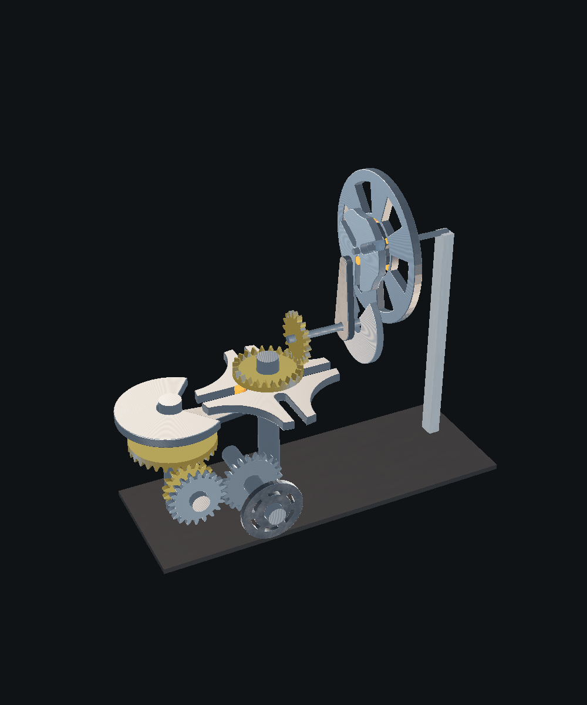
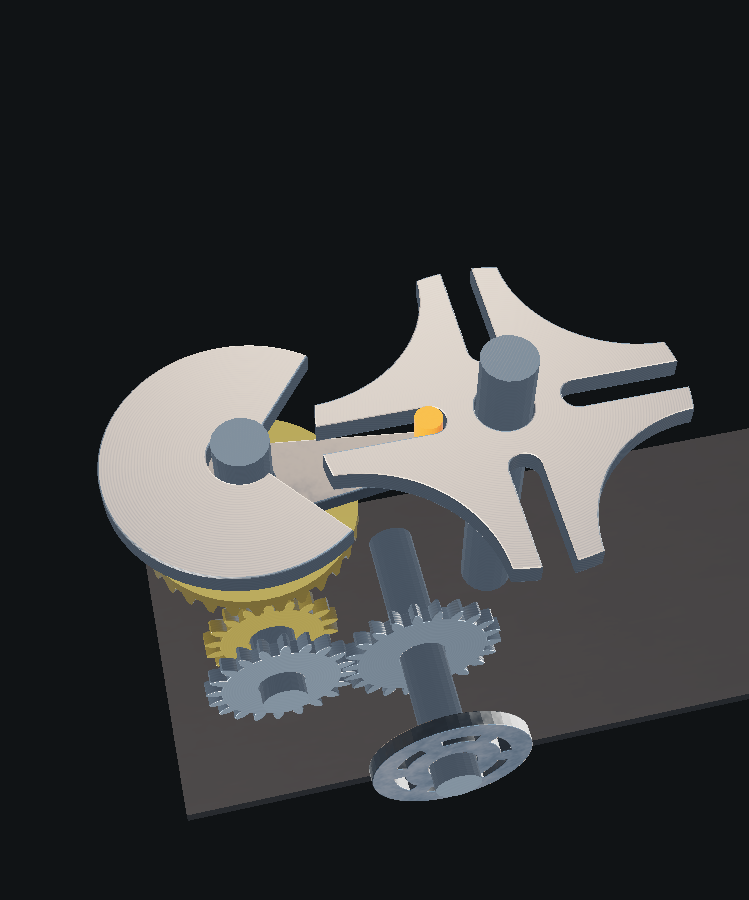

[← Portfolio](https://abrahamsabu.github.io/portfolio/) · [All projects](../../README.md) · [Live site](https://heloria-next.vercel.app)

# Heloria Labs website

**The company site, built around one WebGL machine that assembles itself across seven stages as you scroll. It's finished and running by the time you reach the bottom.**



| The finished machine | The Geneva drive stage |
|---|---|
|  |  |

## Highlights

- One fixed 3D canvas sits beside the whole page while the content scrolls past it.
- Each stage adds a real mechanism, including gears, a Geneva drive and a freewheel.
- 16 test suites check the mechanisms and the motion (`npm run test:*`).

## Stack

Next.js 16 · React 19 · three.js · React Three Fiber · Tailwind CSS 4 · TypeScript

## How to run

```bash
npm install
npm run dev
```

Then open http://localhost:3000. [ARCHITECTURE.md](ARCHITECTURE.md) explains how the page and the machine fit together.
