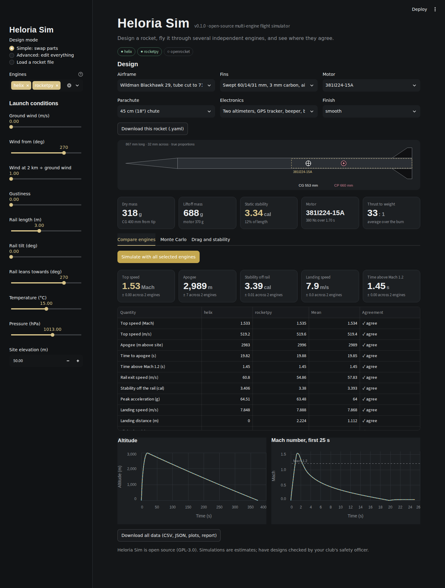
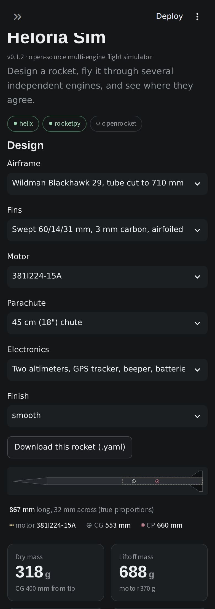
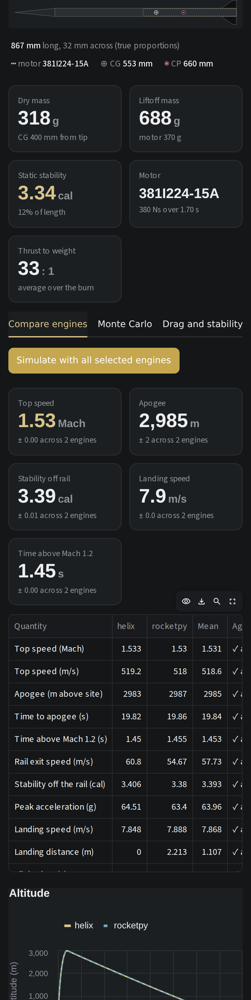
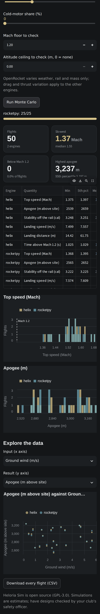
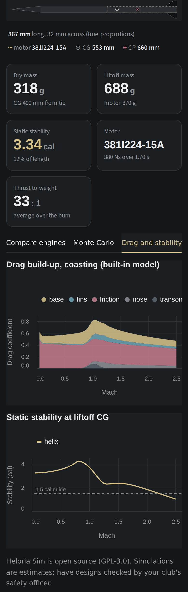

[← Portfolio](https://abrahamsabu.github.io/portfolio/) · [All projects](../../README.md) · [Project page](https://abrahamsabu.github.io/portfolio/projects/heloria-sim/)

# Heloria Sim

**An open-source high-power rocket flight simulator. It runs one design through several independent simulation engines, shows where they agree and where they don't, then flies it hundreds or thousands of times with randomised weather, build and motor variation.**

Built by Heloria Labs for a supersonic rocket project; free for anyone to use and improve.



| | | | |
|---|---|---|---|
|  |  |  |  |

## Quick start

You need [Python 3.10+](https://python.org). For the OpenRocket engine you also need Java 17+.

```bash
git clone --depth 1 --filter=blob:none --sparse https://github.com/AbrahamSabu/portfolio.git heloria-sim
cd heloria-sim
git sparse-checkout set projects/heloria-sim .streamlit
cd projects/heloria-sim
pip install -e ".[all]"
heloria-sim app
```

The app opens in your browser at **http://localhost:8501**. `pip install -e .` on its own installs just the core and
the built-in engine.

For OpenRocket, press **Download the OpenRocket engine** in the app's sidebar once, or download the jar from
openrocket.info (24.12 or newer) and point to it:

```bash
export HELORIA_OR_JAR=/path/to/OpenRocket-24.12.jar
```

## How it works

| Step | In the app | What happens |
|---|---|---|
| **1. Design** | Simple, Advanced, or load a file | **Simple:** pick an airframe, fins, motor, parachute, electronics and finish from the parts catalogue. **Advanced:** edit every dimension, material, wall thickness, mass override, fin shape and edge profile, motor (or upload any `.eng` thrust curve), parachute, and a table of extra masses. A true-scale drawing updates as you go |
| **2. Compare engines** | Compare engines tab | Each engine is given exactly the same rocket (same masses, geometry, motor and weather). The table flags any quantity where the engines differ by more than a set tolerance, because that is where the physics is uncertain |
| **3. Monte Carlo** | Monte Carlo tab | Flies the design many times, varying ground wind and direction, winds aloft, gusts, rail tilt (leaned into the wind), temperature, pressure, build mass, motor thrust, drag scale and cold motors |
| **4. Drag and stability** | Drag and stability tab | Drag and stability charts for the design |
| **5. Download** | Download buttons | The rocket as `.yaml`, every flight as CSV, and all the data (CSV, JSON, plots and a report) as one zip |

### Engines

| Engine | What it is | Drag | Needs |
| --- | --- | --- | --- |
| `helix` | Built-in 3-DOF point-mass trajectory | Independent textbook build-up (skin friction, nose and fin wave drag, base drag); Barrowman stability | Nothing extra |
| `rocketpy` | [RocketPy](https://github.com/RocketPy-Team/RocketPy) 6-DOF | Takes the curve from `helix`; its own stability and dynamics | `pip install rocketpy` |
| `openrocket` | [OpenRocket](https://openrocket.info) 6-DOF, called through its Java API | OpenRocket's own aerodynamics | Java 17+, the OpenRocket jar, `pip install jpype1` |

On the Heloria v8 example (CTI I224, 29 mm minimum diameter), calm day:

| | helix | rocketpy | openrocket | mean |
| --- | --- | --- | --- | --- |
| Top speed (Mach) | 1.471 | 1.473 | 1.445 | 1.463 |
| Apogee (m) | 2,989 | 3,002 | 2,939 | 2,977 |
| Stability off the rail (cal) | 3.32 | 3.29 | 3.29 | 3.30 |
| Landing speed (m/s) | 8.09 | 8.13 | 8.10 | 8.11 |

### Data you get

- `ensemble_summary.csv`: every quantity, per engine, mean, spread and whether the engines agree
- `timeseries_<engine>.csv`: time, position, altitude, speed, Mach, acceleration, thrust, drag, Cd, mass, stability
- `monte_carlo.csv`: one row per flight per engine, with every sampled input and every output
- `report.json` and `report.html`: summaries, percentiles, Mach-floor and ceiling checks, plots

OpenRocket cannot scale thrust or drag, so in Monte Carlo it varies only the weather, rail and mass; the table records
which inputs each engine used.

## Command line and Python

```bash
heloria-sim engines                                    # which engines are installed
heloria-sim motors                                     # built-in motor library
heloria-sim run examples/heloria_v8.yaml --mc 500 --ceiling 3200 --out results/
```

```python
from heloria_sim import Rocket
from heloria_sim.analysis import run_ensemble, run_monte_carlo, export
r = Rocket.load("examples/heloria_v8.yaml")
ens = run_ensemble(r)                       # all available engines
rows = run_monte_carlo(r, n=500)            # list of dicts, one per flight per engine
export("results", r, ens, rows, mach_floor=1.2, ceiling=3200)
```

## Make it your own

- **Your rocket:** plain YAML, see `examples/heloria_v8.yaml`. Lengths in metres, masses in kilograms, positions from
  the nose tip. Leave a `mass` as `null` to have it calculated from dimensions and material.
- **Your parts:** add airframes, fins, parachutes and more to `heloria_sim/data/catalog.yaml`.
- **Your motors:** drop any `.eng` file from [ThrustCurve.org](https://www.thrustcurve.org) into `heloria_sim/data/motors/`.
- **Another engine:** an engine is a module with `NAME`, `available()` and
  `run(rocket, thrust_scale=1, drag_scale=1, time_scale=1, extra_mass=0, seed=None) -> FlightResult`. Register it in
  `heloria_sim/engines/__init__.py`, list which Monte Carlo inputs it supports, and it joins the ensemble, the app and the CLI.

## Put it online (free)

The app runs on [Streamlit Community Cloud](https://streamlit.io/cloud) straight from GitHub:

1. Fork this repository on GitHub.
2. Sign in at share.streamlit.io with GitHub, click **Create app**, pick the repository, branch `main`, and main file
   `projects/heloria-sim/streamlit_app.py`.
3. Click **Deploy**. The first build takes a few minutes. You get a public link that works on phones and computers.

The built-in engine and RocketPy work immediately. `packages.txt` installs Java, so the OpenRocket engine works too:
press **Download the OpenRocket engine** in the sidebar once.

## Limitations

- `helix` is 3-DOF: the rocket follows the airflow with a short lag, so it does not model angle of attack, roll, or
  coning. Stability is static margin.
- RocketPy uses the `helix` drag curve, so for drag the ensemble has two independent sources (helix and OpenRocket),
  not three. Adding RASAero II or another drag source is the most useful next contribution.
- Single stage, one parachute event, no clusters yet.
- The built-in motor library is small.
- Simulations are estimates. Have any design checked by your club's safety officer before flying.

## Project layout

```
heloria_sim/app.py          the Streamlit web app
heloria_sim/ui.py           styling, the live rocket drawing and chart helpers
heloria_sim/spec.py         rocket and launch description shared by every engine
heloria_sim/catalog.py      Simple mode: builds a rocket from catalogue parts
heloria_sim/physics.py      motors, atmosphere and the built-in aerodynamic model
heloria_sim/analysis.py     engine ensemble, Monte Carlo and exports
heloria_sim/engines/        helix, RocketPy and OpenRocket engines
heloria_sim/data/           parts catalogue and motor thrust curves
heloria_sim/cli.py          the heloria-sim command
examples/                   Heloria v8 as YAML and OpenRocket (.ork)
streamlit_app.py            entry point for Streamlit Community Cloud
index.html                  the project page on the portfolio site
```

## License

[GPL-3.0-or-later](LICENSE), so it can work alongside OpenRocket (GPLv3). OpenRocket and RocketPy are separate projects
with their own licences; Heloria Sim calls them at run time and does not bundle them.
