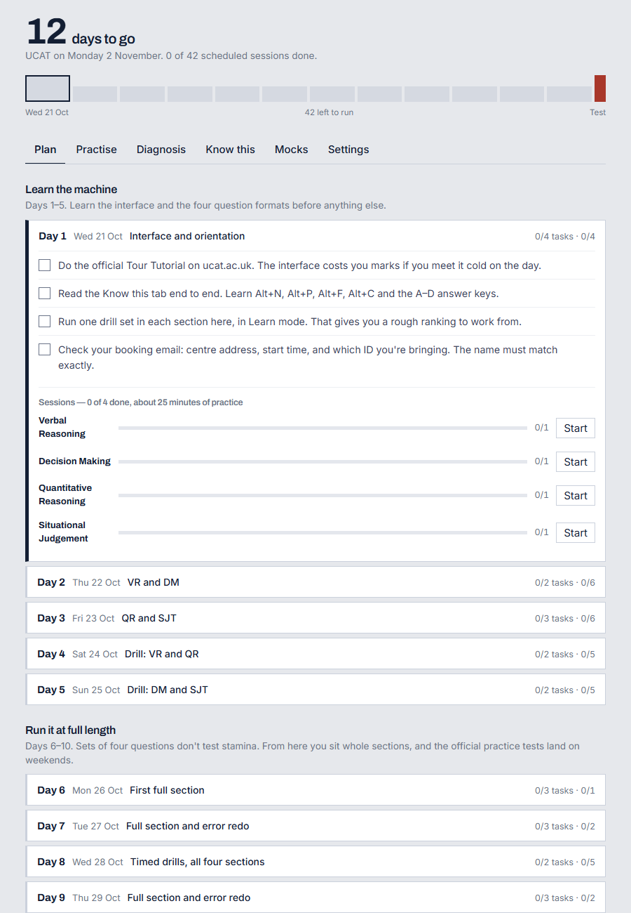

[← Portfolio](https://abrahamsabu.github.io/portfolio/) · [All projects](../../README.md) · [Open the app](https://abrahamsabu.github.io/portfolio/projects/ucat-tracker/)

# UCAT Prep

**A free UCAT study app. Enter your test date and it builds a day-by-day plan, writes fresh practice questions with AI, times you like the real test, and tracks every error until you've fixed it.**

**[Open it in your browser →](https://abrahamsabu.github.io/portfolio/projects/ucat-tracker/)** Nothing to install, no account.

## What it does

| Tab | What you get |
|---|---|
| **Plan** | A day-by-day plan from today to your test, in three phases: learn the formats, then full-length practice with the official tests on weekends, then a two-day taper. Each day has tasks to tick and practice sessions to run |
| **Practise** | Drill sets for Verbal Reasoning, Decision Making, Quantitative Reasoning and Situational Judgement, in Learn mode (explained as you go) or Timed mode. Full-length timed sections, a two-hour full mock, and a mock library you build once and reuse |
| **Diagnosis** | Accuracy by section and by question type, trend lines, and the single weakest area to work on next |
| **Know this** | Keyboard shortcuts, calculator quirks, timings and traps for every section, a test-day checklist, and a calculator speed test (mouse vs numpad) |
| **Mocks** | Log your official practice test scores (VR, DM and QR on 300–900, SJT band 1–4) |
| **Settings** | Your test date, your API key, export and import of progress, and a full reset |

There's also an exam-style calculator in DM and QR, A–D answer keys, Alt+N / Alt+F shortcuts, a flag-and-review screen, and an error log. Get a question right twice and it retires from the log.

## AI questions

The questions are written fresh by Claude in the real UCAT formats, and each one is checked automatically (for example, QR answers must match their own working). To generate them, paste your own [Anthropic API key](https://console.anthropic.com) in **Settings** and pick a model:

- **Claude Opus 5.5:** best questions (the default).
- **Claude Sonnet 5.5:** faster and cheaper.
- **Claude Haiku 5.5:** fastest and cheapest.

Without a key you still get the built-in sample sets and every other feature.

Your key is stored only in your browser and sent only to Anthropic. Set a monthly spend limit on it, and don't save it on a shared computer.

These are practice questions, not past papers. Keep the four official practice tests on [ucat.ac.uk](https://www.ucat.ac.uk) for your real mocks, because those are the calibrated ones.

## Your data

Everything is saved in your own browser: plan, ticks, sessions, error log and mocks. Use **Settings → Export progress** to back it up or move it to another device. The export never includes your API key.

## Run it yourself

It's one HTML file with no build step and no dependencies. Download [`index.html`](index.html) and open it, or host it anywhere static.
It also runs as a Claude.ai artifact, where it uses the artifact's own storage and API access, so no key is needed there.

## License

[MIT](LICENSE)
